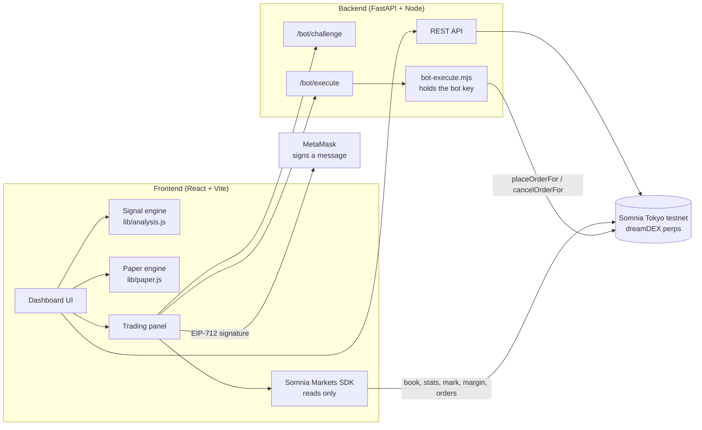

<div align="center">


# PerpPilot AI

### Trade-intelligence cockpit for dreamDEX perps on Somnia

**Navigate markets. Trade with intelligence.**

</div>

PerpPilot AI is a trader tool for **dreamDEX perpetual markets** on the Somnia Tokyo testnet (Hideki, chain `50383`). It turns live order-book and candle data into a readable trade idea, sizes the position against your risk budget, lets you rehearse it with a paper account, and then places and cancels real testnet limit orders from your own wallet.

> The signal never trades for you. Every on-chain action is a transaction you review and approve in your wallet.

---

## Who it is for

- **Perps traders who want a second opinion**, with the reasoning shown in plain English instead of a bare "LONG".
- **New dreamDEX users** who want to practise sizing and stop placement before risking collateral.
- **Builders** looking for a working example of the Somnia Markets SDK: market data, order book tops, margin reads, order placement and cancellation, and smart-account trading.

## What it does

| Area | What you get |
|---|---|
| Live market data | All dreamDEX perp markets, mark price, best bid / best ask from the on-chain book, trailing 24h volume and trade count, candles at 5m / 15m / 1h / 4h |
| Signal engine | LONG / SHORT / HOLD with a confidence score from EMA 9/21, RSI 14, MACD, ATR volatility, trend-vs-chop regime and recent support / resistance |
| Explanations | A plain-English "why this signal" panel, a risk rating (Low / Medium / High) and the exact condition that would invalidate the idea |
| Trade plan | Entry, ATR-based stop-loss and two targets (1.5R, 2.5R) |
| Position sizing | Risk calculator: equity, risk %, stop distance gives size, leverage and required margin, with warnings. One click fills the order form |
| Paper trading | 10,000 virtual USDso, long / short from any signal, live profit and loss, automatic stop / target closes, full trade history, win rate and R multiple |
| Real testnet orders | Place and cancel limit orders for your dreamDEX wallet through a linked bot. MetaMask signs a one-time authorization for each action; the bot sends the transaction. Pre-checks for lot size, tick size, minimum size and available capacity |
| Account monitor | Equity, collateral, margin health, margin used, buffer above maintenance, and each open order's distance from the live mark |
| On-chain market state | Live mark price, funding rate and open interest read from the perp pool, plus best bid / ask and 24h volume |
| Wallet | MetaMask or any EIP-1193 wallet, automatic add / switch to chain 50383, chain and account detection |
| Linked-bot trading | Uses dreamDEX's own "Link a bot" feature: the bot can place and cancel orders for your wallet but can never withdraw, and its key never leaves your backend |

## Architecture



More detail: [docs/ARCHITECTURE.md](docs/ARCHITECTURE.md).

## Quick start

**Requirements:** Node.js 20.19+ (or 22), Python 3.10+, MetaMask (or a compatible wallet).

```bash
# 1. Backend helper dependencies (repo root)
cd backend/dreamdex && npm install && cd ../..

# 2. Backend API
python -m venv venv
# Windows: venv\Scripts\activate      macOS/Linux: source venv/bin/activate
pip install -r backend/requirements.txt
uvicorn backend.app.main:app --reload        # http://127.0.0.1:8000

# 3. Frontend (new terminal)
cd frontend
npm install
npm run dev                                   # http://localhost:5173
```

Optional environment files: `frontend/.env.example` (`VITE_API_URL`) and `backend/.env.example` (`FRONTEND_ORIGINS`).

## Trading with real testnet orders

PerpPilot trades for your **dreamDEX wallet** (the account that holds your margin and Perps Arena collateral) through dreamDEX's **Link a bot** feature. A bot can place and cancel orders for your wallet but cannot withdraw.

1. In <https://app.testnet.dreamdex.io> open your wallet panel, choose **Link a bot**, paste the bot address (the address of your own bot key), keep **Perps** enabled and send it a little STT for gas.
2. Put the bot key and addresses in `backend/.env` (never commit this file; see `backend/.env.example` for the variable names). Start the backend and the frontend.
3. In PerpPilot connect MetaMask. The **Trading account** card should show your dreamDEX wallet, the bot, its gas, and "place yes / cancel yes".
4. Pick a market, choose a direction, and set a limit price about 1% to 2% below the best bid for a buy, so the order rests. Click **Review & Sign Limit Order**.
5. MetaMask asks you to **sign a message** (no gas, not a transaction). The backend verifies the signature and the bot sends the order. The transaction hash appears in the **Transaction log**.
6. The order appears under **Your open orders**. Click **Cancel**, sign again, and the cancellation hash is added to the log.

Setup details and a test checklist: [docs/LINK-A-BOT.md](docs/LINK-A-BOT.md).

### Order evidence

| What | Transaction hash | Explorer |
|---|---|---|
| Limit order placed | `<add after first live order>` | |
| Order cancelled | `<add after first live cancel>` | |

## How the signal works

1. **Trend:** EMA 9 versus EMA 21 and the slope of EMA 9.
2. **Momentum:** RSI 14, MACD (12/26) and the last few candles.
3. **Confirmation:** volume versus its 20-candle average.
4. **Context:** an efficiency ratio labels the market Trending, Transitional or Choppy; ATR versus its 50-candle average labels volatility Compressing, Normal or Expanding; recent swing high and low give support and resistance.
5. **Score and confidence:** factors add up to a score; LONG at +6 or above, SHORT at -6 or below, otherwise HOLD. Confidence is reduced in choppy or expanding-volatility markets and near support or resistance.

Rule-based and fully explainable by design. It is a decision aid, not a prediction.

## Safety

- Testnet only. No real funds.
- Nothing is sent without a wallet confirmation. There are no background trades.
- Voucher claims are simulated first and not sent if they would revert, so a failing call does not cost gas.
- Orders are validated against lot size, tick size, minimum size and available capacity before the wallet opens.

## Feedback for dreamDEX

Issues found while building are in [`feedback/`](feedback), one Markdown file each:

- [001: `claimPerpVoucher` reverts with `0x3e31dcc2` although eligibility reports eligible](feedback/001-claimperpvoucher-reverts-0x3e31dcc2.md)
- [002: error selector not present in the SDK's ABIs](feedback/002-error-selector-not-in-sdk-abis.md)
- [003: mark price appears frozen while the book moves](feedback/003-markprice-static-vs-orderbook.md)
- [004: docs gap for obtaining the first STT for gas](feedback/004-docs-first-stt-for-gas.md)

## X posts

<!-- Replace with 2 or 3 real post links that tag @DreamDEXSomnia. Drafts: docs/X-POSTS.md -->

1. `<link to post 1>`
2. `<link to post 2>`
3. `<link to post 3>`

## Project structure

```
backend/
  app/                FastAPI app (market, dreamdex, trading routers)
  dreamdex/           Node helpers: markets-json.mjs (reads), bot-status.mjs, bot-execute.mjs (linked-bot orders)
frontend/
  src/
    App.jsx           Dashboard and layout
    lib/              analysis.js (signals), paper.js (paper engine), sdk.js, useMarketTicker.js
    components/       WalletConnect, PerpTradingPanel, SignalInsights, RiskCalculator, PaperTrading
  (lib/dreamdexBot.js: bot status, challenge and signature flow)
docs/                 Architecture, X post drafts, demo script
feedback/             Reproducible reports for the dreamDEX Feedback track
```

## Tech stack

React 19, Vite, Recharts, viem, `@somnia-chain/markets-sdk` 0.32.1, FastAPI, Node.js.

## Known limitations

- Paper results ignore fees and slippage and are stored in the browser only.
- Prices for paper positions update for the selected market only.
- The signal engine is technical and rule-based; it does not use funding rates or open interest yet.
- Real orders need the backend running, because the linked bot's key is held server-side. The bot and wallet addresses are configured for one account.
- Each order or cancel asks for one MetaMask signature (an authorization valid for 2 minutes and usable once).

## License

MIT. Testnet prototype for the dreamDEX Perps Builder Bounty. Not financial advice.
