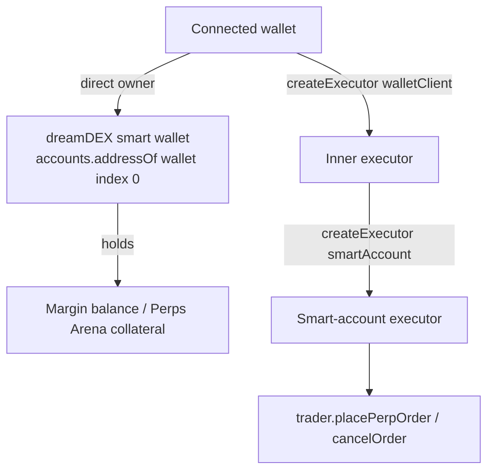

# PerpPilot AI architecture

## Layers

| Layer | Responsibility | Files |
|---|---|---|
| Market feed | Lists perp markets and candles through the Somnia Markets SDK | `backend/dreamdex/markets-json.mjs`, `backend/app/services/dreamdex_*.py`, `backend/app/api/dreamdex.py` |
| Live ticker | Best bid / ask from on-chain top-of-book and trailing 24h stats, refreshed every 30 s | `frontend/src/lib/useMarketTicker.js`, `frontend/src/lib/sdk.js` |
| Signal engine | Indicators, regime, scoring, explanation, trade plan, sizing. Pure functions | `frontend/src/lib/analysis.js` |
| Paper engine | Virtual account, positions, auto-close, history, statistics. Pure functions | `frontend/src/lib/paper.js` |
| Wallet | Connect, add / switch chain 50383, account and chain detection | `frontend/src/components/WalletConnect.jsx` |
| Trading | Margin reads, voucher claim, order placement and cancellation, risk monitor | `frontend/src/components/PerpTradingPanel.jsx` |

## Data flow

1. The backend runs a small Node script that calls the SDK and returns market metadata and candles as JSON.
2. The frontend refreshes every 30 seconds, runs `generateSignal(candles)` and renders the explanation, plan and calculator.
3. The ticker hook reads the on-chain book and 24h stats directly with the SDK (read-only, no wallet).
4. Paper trades are evaluated against the live mid price on every refresh.
5. Real orders go through the trading panel: validate, check capacity, then the wallet signs.

## Trading identity

If a smart wallet derived from the connected wallet exists on chain 50383 and the wallet has authority over it (`accounts.authorityPath`), the panel offers it as the trading account. Otherwise it falls back to the wallet itself.

## Safety design

- No signal path reaches the chain without a wallet confirmation.
- Pre-flight checks: lot size, tick size, minimum size, capacity (`getMaxPerpOrderSize`), STT balance.
- Voucher claims are simulated with `eth_call` first.
- Stale-price guard in the paper engine ignores prices more than 50% from a position's entry.
