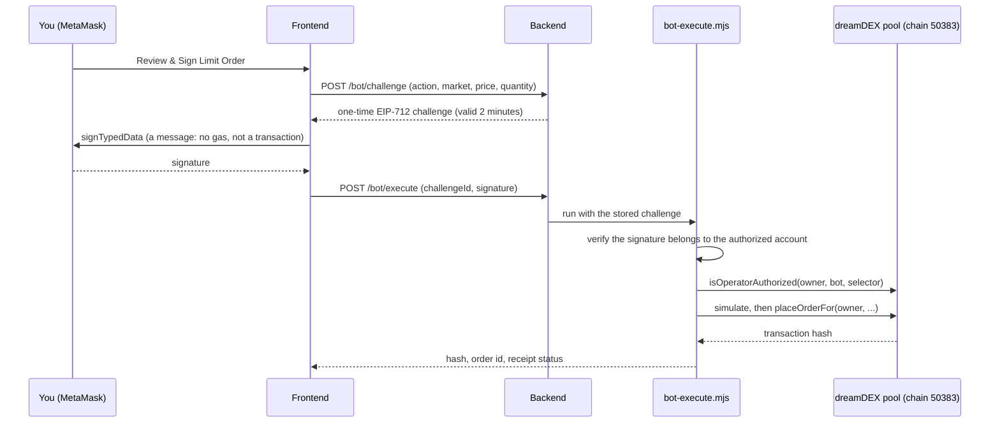
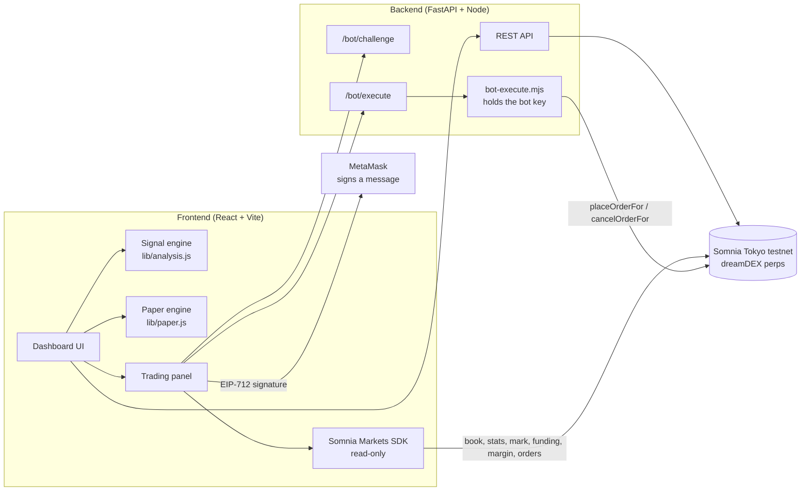

<div align="center">


# PerpPilot AI

### A trade-intelligence cockpit for dreamDEX perpetual markets on Somnia

**Navigate markets. Trade with intelligence.**

Built for the **dreamDEX Perps Builder Bounty** · MVP track · category: trader tool

</div>

---

## Table of contents

1. [What it is](#what-it-is)
2. [Who it is for](#who-it-is-for)
3. [What you can do with it](#what-you-can-do-with-it)
4. [Screenshots](#screenshots)
5. [Live order evidence](#live-order-evidence)
6. [How real orders work](#how-real-orders-work)
7. [Architecture](#architecture)
8. [Quick start](#quick-start)
9. [Using the app](#using-the-app)
10. [How the signal engine works](#how-the-signal-engine-works)
11. [Safety and security](#safety-and-security)
12. [Testing](#testing)
13. [Feedback for dreamDEX](#feedback-for-dreamdex)
14. [X posts](#x-posts)
15. [Project structure](#project-structure)
16. [Tech stack](#tech-stack)
17. [Known limitations and roadmap](#known-limitations-and-roadmap)
18. [License](#license)

---

## What it is

PerpPilot AI turns live dreamDEX perp data into a trade idea you can read, size, rehearse and then execute.

1. It reads every perp market on the Somnia Tokyo testnet (Hideki, chain `50383`): prices, order-book top, 24h volume, funding rate, open interest and candles.
2. A rule-based engine produces a **LONG / SHORT / HOLD** signal and explains it in plain English, with a stop-loss, two targets and the condition that would invalidate the idea.
3. A risk calculator sizes the position from your equity and the loss you accept.
4. A paper-trading account lets you rehearse the idea with virtual money.
5. When you are ready, you place and cancel **real testnet limit orders** for your dreamDEX wallet. MetaMask signs a one-time authorization and your linked dreamDEX bot sends the transaction.

> The signal never trades on its own. Every real order and cancellation needs your MetaMask signature.

## Who it is for

- **Perps traders who want reasons, not just a signal.** Every idea shows which indicators agree and why.
- **New dreamDEX users** who want to practise sizing, stops and risk before committing collateral.
- **Builders** who want a working example of the Somnia Markets SDK together with dreamDEX's *Link a bot* flow for an external app.

## What you can do with it

| Area | Details |
|---|---|
| Live market data | All perp markets, live on-chain mark price, best bid / ask from the order book, trailing 24h volume and trades, funding rate, open interest, candles at 5m / 15m / 1h / 4h |
| Signal engine | LONG / SHORT / HOLD with a confidence score from EMA 9/21, RSI 14, MACD, ATR volatility, trend-versus-chop regime and recent support / resistance |
| Explanations | "Why this signal" in plain English, a Low / Medium / High risk rating, watch levels when there is no edge |
| Trade plan | Entry, ATR-based stop-loss and two targets (1.5R and 2.5R) |
| Position sizing | Equity + risk % + stop distance gives size, leverage and required margin, with warnings. One click fills the order form |
| Paper trading | 10,000 virtual USDso, long / short from any signal, live profit and loss, automatic stop and target closes, trade history, win rate and R multiple |
| Real testnet orders | Place and cancel limit orders for your dreamDEX wallet through a linked bot. Checks lot size, tick size, minimum size and available capacity before anything is signed |
| Account monitor | Equity, collateral, margin health, margin used, buffer above maintenance, and each open order's distance from the live mark |
| Transaction log | Every real transaction hash with Copy and Explorer buttons |
| Wallet | MetaMask or any injected wallet, automatic add / switch to chain 50383, chain and account detection |
| Resilience | Each panel is isolated by an error boundary: one failing panel shows its error and the rest of the app keeps working |

## Screenshots

> Add your screenshots to `docs/screenshots/` using these names.

| | |
|---|---|
|  |  |
| Dashboard with live market data | "Why this signal" and trade plan |
|  |  |
| Paper trading with history and win rate | A real order, its open-orders row and the transaction log |

## Live order evidence

Real orders placed from this app on the Somnia Tokyo testnet (Hideki, chain `50383`).

| Account | Address |
|---|---|
| dreamDEX wallet (holds margin) | `0x893946f0479115b49d49D0A030838609749F9a10` |
| Linked bot (sends orders, cannot withdraw) | `0x34E65aA7867c03F26483f5663aCb5308119D6324` |
| MetaMask account (signs authorizations) | `0x35d5CfCdcacaBF2d50b534a2E50098b5Da192BF6` |

| Action | Market | Transaction hash |
|---|---|---|
| Limit order placed (Short, 0.03666 BTC at 75,818.2 USDso) | BTC-PERP | [`0xcb2f151d0a578a6f0e407eb715238a0985a9c21d432842e1234aa2bae377aee1`](https://explorer.testnet.somnia.network/tokyo/tx/0xcb2f151d0a578a6f0e407eb715238a0985a9c21d432842e1234aa2bae377aee1) |
| Order cancelled | BTC-PERP | `<paste the cancel hash from the Transaction log>` |

## How real orders work

dreamDEX keeps your margin in your **dreamDEX wallet**. dreamDEX's *Link a bot* feature lets a separate bot key place and cancel orders for that wallet, but never withdraw. PerpPilot uses exactly that.



- Each challenge is single-use and expires after 2 minutes.
- The bot key lives only in `backend/.env` and never reaches the browser.
- The SDK (0.32.1) has no perp `placeOrderFor` / `cancelOrderFor` ABI, so the backend ships the ABI for these two operator functions. See [feedback 003](feedback/003-sdk-perp-operator-abi-missing.md).

## Architecture



More detail in [docs/ARCHITECTURE.md](docs/ARCHITECTURE.md).

## Quick start

**Requirements:** Node.js 20.19+ (or 22), Python 3.10+, MetaMask.

```powershell
# 1. Backend helper dependencies
cd backend\dreamdex
npm install
cd ..\..

# 2. Backend API (from the project root)
python -m venv venv
.\venv\Scripts\Activate.ps1
pip install -r backend\requirements.txt
uvicorn backend.app.main:app --reload          # http://127.0.0.1:8000

# 3. Frontend (second terminal)
cd frontend
npm install
npm run dev                                     # http://localhost:5173
```

macOS / Linux: use `source venv/bin/activate` and forward slashes.

### Enable real orders (one-time)

1. In <https://app.testnet.dreamdex.io>, open your wallet panel, choose **Link a bot**, paste your bot's address, keep **Perps** enabled and let dreamDEX send it a little STT for gas.
2. Copy `backend/.env.example` to `backend/.env` and fill in:

| Variable | Meaning |
|---|---|
| `DREAMDEX_BOT_PRIVATE_KEY` | Private key of the bot you linked (`0x` + 64 hex characters) |
| `DREAMDEX_OWNER_ADDRESS` | Your dreamDEX wallet address (holds the margin) |
| `DREAMDEX_REQUESTER_ADDRESS` | The MetaMask account allowed to authorize actions |
| `SOMNIA_RPC_URL` | `https://api.hideki2.infra.testnet.somnia.network` |

3. `backend/.env` is git-ignored. Never commit it or share it.
4. Check <http://127.0.0.1:8000/api/dreamdex/bot/status>: you should see `"status": "ready"` with both permissions `true`.

Without these steps the app still works fully, except for real orders; paper trading, signals and the risk tools need nothing.

## Using the app

1. **Connect** MetaMask. The header shows the account and "Chain 50383 verified".
2. **Pick a market** and an interval. Read the signal and the "Why this signal" panel.
3. **Size it** in the risk calculator. Press **Use in order form** to fill the trading form.
4. **Rehearse it** with **Open LONG / SHORT paper trade**. Trades close automatically at the stop or target.
5. **Place it for real:** set a limit price, press **Review & Sign Limit Order** and sign in MetaMask. The hash appears in the Transaction log.
6. **Cancel** from the open-orders table, sign again, and the cancellation hash is logged.

Tip: for a resting test order, price a buy about 1% to 2% below the best bid.

## How the signal engine works

1. **Trend:** EMA 9 versus EMA 21 and the slope of EMA 9.
2. **Momentum:** RSI 14, MACD (12/26) and the last few candles.
3. **Confirmation:** volume versus its 20-candle average.
4. **Context:** an efficiency ratio labels the market Trending, Transitional or Choppy; ATR versus its 50-candle average labels volatility Compressing, Normal or Expanding; the recent swing high and low give support and resistance.
5. **Score and confidence:** the factors add up to a score. LONG at +6 or above, SHORT at -6 or below, otherwise HOLD. Confidence is reduced in choppy or expanding-volatility markets and near support or resistance.
6. **Plan:** stop at 1.5 x ATR, targets at 1.5R and 2.5R.

The engine is rule-based and fully explainable. It is a decision aid, not a prediction.

## Safety and security

- Testnet only. No real funds.
- Nothing is sent without your MetaMask signature. There are no background trades.
- The bot can place, cancel and reduce orders for your wallet. It cannot withdraw.
- The authorization you sign is single-use and expires after 2 minutes.
- The bot key never leaves the backend. Anyone with the key can trade your account and spend the bot's gas; if it is ever shared, unlink the bot in dreamDEX and link a new one.
- The backend API is meant for local use. Do not expose it publicly without adding authentication.
- Orders are checked against lot size, tick size, minimum size and capacity before the wallet opens.

## Testing

| Area | How it was checked |
|---|---|
| Wallet connect, chain 50383 detection, account detection | Manual, in the browser with MetaMask |
| Market switching, intervals, refresh | Manual |
| Live book, 24h stats, mark, funding, open interest | Manual against the live testnet |
| Signal engine and risk maths | Scripted checks on synthetic candles (uptrend, downtrend, chop) |
| Paper engine | Scripted scenarios: take-profit, stop-loss, manual close, duplicates, bad inputs, stale-price guard |
| Real order placement | Manual: order placed, hash in the log, order visible on-chain |
| Real order cancellation | Manual: see the evidence table above |
| Code quality | `npm run lint` clean on all source files |

## Feedback for dreamDEX

Issues found while building are in [`feedback/`](feedback), one Markdown file each:

- [001: `claimPerpVoucher` reverts with `0x3e31dcc2` although eligibility reports eligible](feedback/001-claimperpvoucher-reverts-0x3e31dcc2.md)
- [002: that error selector is not in the SDK's ABIs](feedback/002-error-selector-not-in-sdk-abis.md)
- [003: SDK has no perp `placeOrderFor` / `cancelOrderFor` ABI for linked bots](feedback/003-sdk-perp-operator-abi-missing.md)
- [004: docs gap for obtaining the first STT for gas](feedback/004-docs-first-stt-for-gas.md)

## X posts

<!-- Replace with 2 or 3 real links to posts that tag @DreamDEXSomnia. Drafts are in docs/X-POSTS.md -->

1. `<https://x.com/jadoon_hajra/status/2118591863007728111>`
2. `<https://x.com/jadoon_hajra/status/2118592977253613894>`
3. `<link to post 3>`
## Project structure

```
backend/
  app/
    main.py             FastAPI app
    api/                dreamdex.py (market data), dreamdex_bot.py (bot status, challenge, execute)
    services/           market and candle services
  dreamdex/             Node helpers: markets-json.mjs, bot-status.mjs, bot-execute.mjs
frontend/
  src/
    App.jsx             Dashboard and layout
    lib/                analysis.js, paper.js, sdk.js, useMarketTicker.js, dreamdexBot.js
    components/         WalletConnect, PerpTradingPanel, SignalInsights, RiskCalculator,
                        PaperTrading, ErrorBoundary
docs/                   Architecture, linked-bot guide, X post drafts, demo script
feedback/               Reproducible reports for the dreamDEX Feedback track
```

`backend/app/services/weex_*.py` and `backend/app/api/trading.py` are leftovers from an earlier project, disabled by default and not used by PerpPilot.

## Tech stack

React 19, Vite, Recharts, viem, `@somnia-chain/markets-sdk` 0.32.1, FastAPI, Node.js, MetaMask (EIP-712 signing).

## Known limitations and roadmap

- Real orders need the backend running because the linked bot's key is held server-side. The configured bot, wallet and requester are for one account.
- Each order or cancel needs one MetaMask signature (valid 2 minutes, single use).
- Paper results ignore fees and slippage and are stored in the browser only.
- Paper positions update only for the market that is currently selected.
- The signal engine is technical and rule-based; it does not yet use funding or open-interest changes as inputs.
- Roadmap: funding-aware signals, take-profit / stop-loss orders for real positions, multi-account support, and a read-only hosted demo.

## License

MIT. Testnet prototype for the dreamDEX Perps Builder Bounty. Not financial advice.